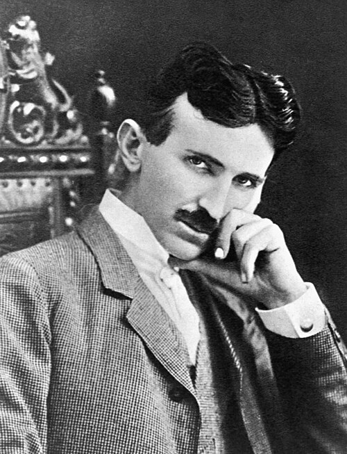
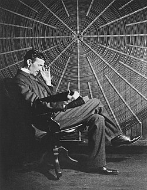
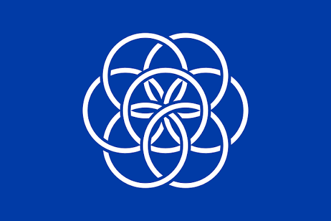

# you dont understand. i need more knowledge. im literally nikolas tesla.

   

## Quotes youll need
Fall seven times and stand up eight. –Japanese Proverb

When I was 5 years old, my mother always told me that happiness was the key to life.  When I went to school, they asked me what I wanted to be when I grew up.  I wrote down ‘happy’.  They told me I didn’t understand the assignment, and I told them they didn’t understand life. –John Lennon

There is only one way to avoid criticism: do nothing, say nothing, and be nothing. –Aristotle

The best time to plant a tree was 20 years ago. The second best time is now. –Chinese Proverb

The person who says it cannot be done should not interrupt the person who is doing it. –Chinese Proverb

# Hi there 👋

## known as kiwi on the internet. tho that only applies if i am known. which i am not(make me famous)

### these are my favourit projects on my main account(this is only my school accont):

[Navi. this project  is a browser(kinda) i made](https://github.com/humanglobalist/navi-browser)

[CoE. a project to unite humanity.](https://github.com/humanglobalist/citizenofearth)

### most of the time, i dont give a fuck. do what the fuck you want to public license.
#### if any of my projects are unlicensed and have been unlicensed for months, it means anyone can use them. i really dont give a fuck.

## wanna see more of me and what i do? go to [humanglobalist](https://github.com/humanglobalist) or [My Noiz account](https://noiz.bio/kiwihtml)

<!--
**omxromxr/omxromxr** is a ✨ _special_ ✨ repository because its `README.md` (this file) appears on your GitHub profile.

Here are some ideas to get you started:

- 🔭 I’m currently working on ...
- 🌱 I’m currently learning ...
- 👯 I’m looking to collaborate on ...
- 🤔 I’m looking for help with ...
- 💬 Ask me about ...
- 📫 How to reach me: ...
- 😄 Pronouns: ...
- ⚡ Fun fact: ...
-->
