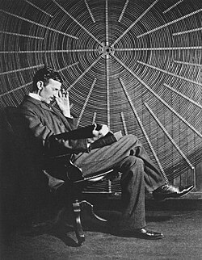

# du förstår inte. jag behöver mer kunskap. jag är bokstavligen nikolas tesla.

   

## Citat du kommer att behöva
Falla sju gånger, res dig åtta. –Japanskt ordspråk

När jag var 5 år sa min mamma alltid att lycka var nyckeln till livet. När jag började skolan frågade de vad jag ville bli när jag blev stor. Jag skrev ner ‘lycklig’. De sa att jag inte förstod uppgiften, och jag sa till dem att de inte förstod livet. –John Lennon

Det finns bara ett sätt att undvika kritik: gör ingenting, säg ingenting och var ingenting. –Aristoteles

Den bästa tiden att plantera ett träd var för 20 år sedan. Den näst bästa tiden är nu. –Kinesiskt ordspråk

Den som säger att det inte går att göra bör inte avbryta den som gör det. –Kinesiskt ordspråk

# Hej där 👋

## känd som kiwi på internet. fast det gäller bara om jag är känd. vilket jag inte är (gör mig känd)

### det här är mina projekt på mitt huvudkonto (det här är bara mitt skolkonto):

[Navi. det här projektet är en webbläsare (typ) som jag har gjort](https://github.com/humanglobalist/navi-browser)

[CoE. ett projekt för att förena mänskligheten.](https://github.com/humanglobalist/citizenofearth)

### för det mesta skiter jag i det. gör-vad-fan-du-vill-licensen (do what the fuck you want to public license).
#### om något av mina projekt saknar licens och har gjort det i månader betyder det att vem som helst får använda det. jag skiter verkligen i det.

## vill du se mer av mig och vad jag gör? gå till [humanglobalist](https://github.com/humanglobalist) eller [mitt Noiz-konto](https://noiz.bio/kiwihtml)

jag gjorde faktiskt ett skämt, det är dåligt, men det är ett skämt: varför älskar kommunister Minröjaren? för att de får sätta ut röda flaggor
